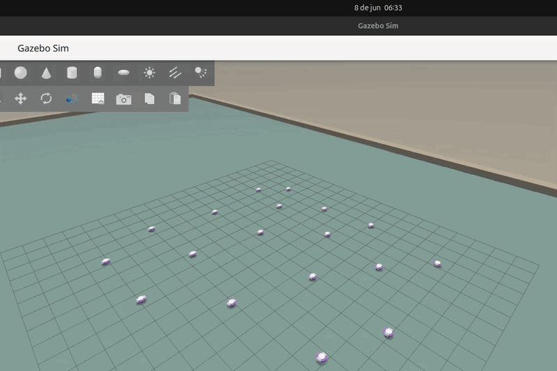
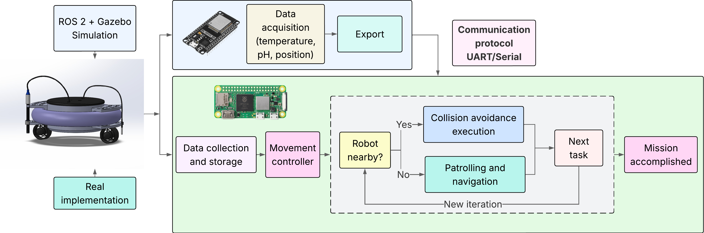
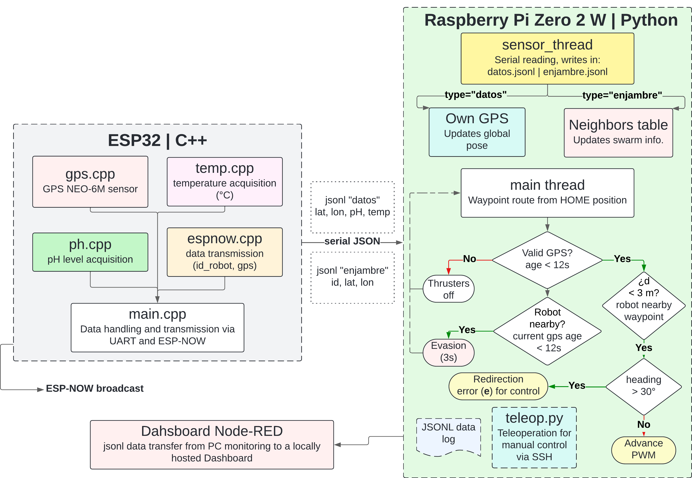
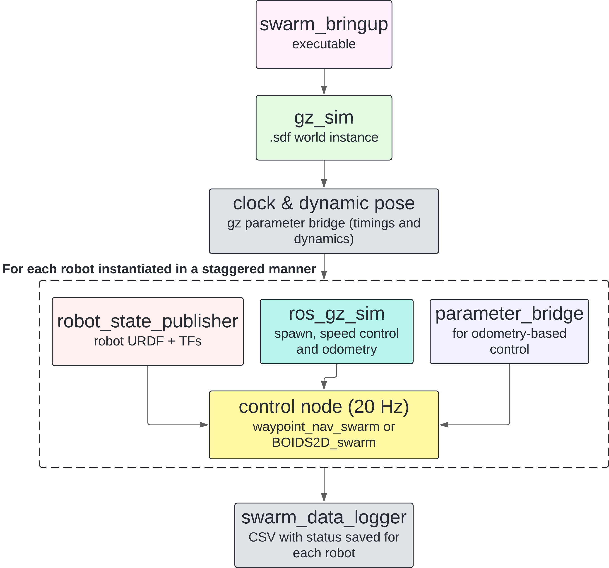
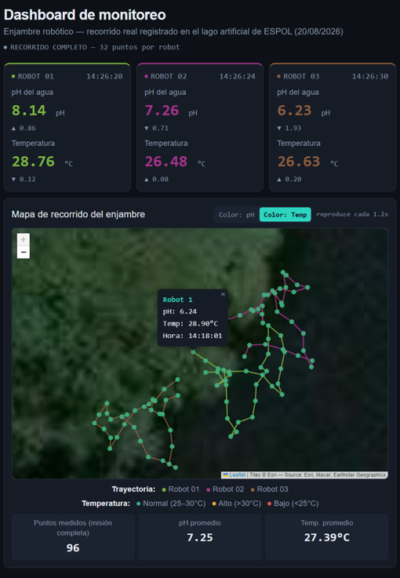

# Proyecto de Tesis de Grado: Robótica de Enjambre Acuática de Superficie para Monitoreo Ambiental

<p align="right">
  <a href="README.md">🇬🇧 <b>English</b></a> &nbsp;|&nbsp; 
  <a href="README.es.md">🇪🇸 <b>Español</b></a>
</p>

[](https://docs.ros.org/en/jazzy/)
[](https://gazebosim.org/)
[](https://www.raspberrypi.com/)
[](https://www.espressif.com/)
[](https://www.espressif.com/)
[](#-aviso-de-investigación-y-propiedad-intelectual)

Un enjambre descentralizado integral de **Vehículos Autónomos de Superficie (USVs)** diseñado para la evaluación espacio-temporal continua de la calidad del agua (pH y temperatura). El sistema elimina la necesidad de operadores humanos en embarcaciones e infraestructura celular al integrar **simulación hidrodinámica de alta fidelidad en ROS 2 / Gazebo Harmonic**, comunicación ad-hoc distribuida punto a punto (P2P) y despliegues físicos multiagente en campo.

Desarrollado en el **Laboratorio CoRAL (ESPOL)**.

---

## 🎬 Despliegues en Campo y Demostración Sim-to-Real

### Despliegue Físico (Lago de ESPOL)
<p align="center">
  
  <br>
  <em>Pruebas de los 3 USVs en el lago</em>
</p>

### Simulación Hidrodinámica del Enjambre (Gazebo)
<p align="center">
  
  <br>
  <em>Pruebas de escalabilidad multiagente (hasta 20 nodos simultáneos)</em>
</p>

> 📺 **Demostraciones en Video:**  
> - 🇪🇨 & 🇪🇸 [Ver misiones autónomas de 3 agentes y breve explicación (YouTube)](https://youtu.be/UMnkEa_evzY)  
> - 🏊 [Ver pruebas de desarrollo de simulación (Lista de reproducción en YouTube)](https://youtube.com/playlist?list=PL8n_4KnNGx2n-5VLmENLNj3OTQICQIQzr&si=vs_kWSMrW3dEg3GG)  
> - 🏊 [Ver la publicación de la facultad sobre este proyecto (Reel en Instagram)](https://www.instagram.com/reel/DceYdwiy3MX/?mdxt=MzRlODBiNWFlZA==)  
> - | *Todas las misiones fueron realizadas en entornos reales como lagos (ESPOL y UAM) y piscinas* |

---

## 📌 Arquitectura del Sistema

La plataforma USV se fundamenta en una arquitectura embebida híbrida distribuida, desacoplando la navegación autónoma de alto nivel de la adquisición de datos en tiempo real y la red punto a punto.

### 1. Navegación de Alto Nivel (Raspberry Pi Zero 2 W)
- Ejecuta seguimiento de trayectorias, máquinas de estado de misión y nodos de ROS 2 (en desarrollo activo) sobre un entorno Linux embebido.
- Traduce los waypoints geográficos objetivo en consignas continuas de rumbo y empuje.
- Genera señales PWM para los **propulsores submarinos APISQUEEN**, integrando mecanismos de corte de emergencia inmediato.

### 2. Control de Bajo Nivel y Red Mesh Ad-Hoc (ESP32)
- Interactúa directamente con el hardware: interfaces analógicas y digitales para sondas de pH y temperatura de grado industrial.
- Ejecuta la estimación de orientación (yaw) mediante IMU y el posicionamiento GPS.
- Aloja el protocolo de comunicación descentralizado **ESP-NOW**, manteniendo tablas dinámicas de vecindad sin depender de routers Wi-Fi locales ni redes celulares 4G/5G.

<p align="center">
  
  <br>
  <em>Figura 1: Arquitectura embebida dual de hardware y software de la plataforma de enjambre acuático.</em>
</p>

---

## ⚡ Capacidades Principales de Ingeniería

### 1. Coordinación Descentralizada y Red Mesh ESP-NOW
- Los nodos transmiten periódicamente sus coordenadas locales, orientación y vectores de velocidad.
- El enjambre divide y cubre cuerpos de agua extensos de forma autónoma sin depender de un servidor central.
- Cuando dos agentes detectan trayectorias convergentes dentro del radio de seguridad, las políticas reactivas descentralizadas de evasión de colisiones modulan el empuje diferencial de forma determinista.

<p align="center">
  
  <br>
  <em>Figura 2: Control basado en waypoints con GPS + IMU y comunicación entre agentes del enjambre.</em>
</p>

### 2. Transferencia Sim-to-Real (ROS 2 Jazzy + Gazebo Harmonic)
- Modelado de la hidrodinámica completa de cuerpo rígido (flotabilidad, tensores de arrastre y amortiguamiento hidrodinámico en desarrollo actual) mediante URDF.
- Evaluación de algoritmos de control de enjambre: algoritmo propietario basado en BOIDS 2D (aún no probado en escenarios reales) y algoritmos basados en waypoints (validados en entornos reales como se observa en los videos).
- Escalado de misiones multi-robot de hasta **20 agentes simultáneos** en simulación previo a la manufactura física.

<p align="center">
  
  <br>
  <em>Figura 3: Arquitectura del puente y ciclo de vida en ROS 2 / Gazebo Harmonic para despliegues multiagente.</em>
</p>

### 3. Telemetría Continua de Calidad del Agua
- En lugar de capturar muestras puntuales aisladas, los vehículos registran series temporales geoespaciales continuas.
- La telemetría en tiempo real (pH, °C, posición GPS y marcas de tiempo) se transmite a un **panel de supervisión operativa en Node-RED**.

<p align="center">
  
  <br>
  <em>Figura 4: Panel de visualización de telemetría en vivo, trayectorias GPS y sensado ambiental.</em>
</p>

---

## 📊 Especificaciones Técnicas

| Parámetro | Especificación | Detalles |
| :--- | :--- | :--- |
| **Tamaño del Enjambre** | 3 Unidades Físicas (Escalable) | Simulado hasta 20 nodos en Gazebo Harmonic |
| **Cómputo Principal (SBC)** | Raspberry Pi Zero 2 W | Quad-core ARM Cortex-A53 @ 1 GHz, 512MB RAM |
| **MCU de Tiempo Real** | ESP32-WROOM-32 | Dual-core Tensilica Xtensa de 32 bits @ 240 MHz |
| **Comunicaciones Inter-Agente** | ESP-NOW (2.4 GHz) | Entrega de paquetes ad-hoc punto a punto sin infraestructura de red externa |
| **Sensores** | GPS, IMU, pH, Temperatura | Adquisición continua de series temporales |
| **Propulsión** | Propulsores Submarinos APISQUEEN | Configuración de empuje diferencial para rotación en superficie |
| **Alimentación** | LiPo 3S (11.1V, Alta Capacidad) | ~9 horas de autonomía en misión continua |
| **Chasis y Estructura** | Flotador Anular Híbrido + Núcleo 3D | Carcasa impermeable IP67 personalizada con acceso modular para mantenimiento |
| **Costo de Fabricación Unitario**| ~$600 USD por nodo | Alternativa accesible frente a boyas comerciales de un solo vehículo |

---

## 🗺️ Campos de Aplicación Práctica

- **Investigación Académica en Sistemas Multiagente:** Plataforma modular accesible para algoritmos de consenso distribuido, cobertura por teselación de Voronoi y planificación cooperativa de trayectorias.
- **Acuicultura Industrial y Camaroneras:** Monitoreo continuo de la estratificación de pH y cambios críticos de temperatura en piscinas extensas sin requerir cuadrillas en botes.
- **Estuarios, Ríos y Embalses:** Detección temprana de vertidos de efluentes industriales y seguimiento de límites ecológicos.

---

## 📁 Estructura del Repositorio

```text
aquatic_surface_swarm_robotics/
├── README.md                            # Estudio de caso del proyecto (versión en inglés)
├── README.es.md                         # Versión en español del estudio de caso (este archivo)
├── media/                               # Recursos visuales, gráficas de telemetría y esquemas
│   ├── fleet_lake_espol.gif             # 3 USVs operando en el lago de ESPOL
│   ├── dual_architecture.png            # Arquitectura dual del sistema de enjambre acuático
│   ├── waypoint_based_control.png       # Algoritmo de control basado en waypoints implementado
│   ├── gazebo_swarm_simulation.gif      # Demostración de la simulación de agentes
│   ├── dashboard_nodered.png            # Interfaz del panel de control en vivo en Node-RED
│   ├── hardware_chassis_render.png      # Vista explosionada CAD 3D en SolidWorks
│   ├── physical_connections.jpg         # Conexiones electrónicas reales
│   └── pcb_design.jpg                   # PCB diseñada en KiCad, extensión de pines ESP32
