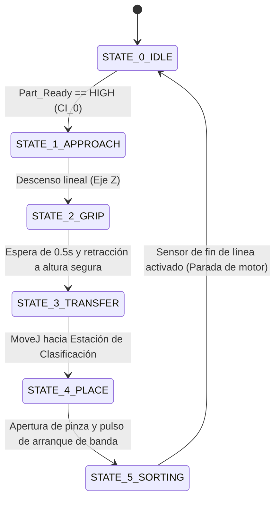

# Reacondicionamiento Mecatrónico e Integración de Cobot: UFACTORY Lite 6 con Estaciones Didácticas Festo MPS

<p align="right">
  <a href="README.md">🌐 <b>English</b></a> &nbsp;|&nbsp; 
  <a href="README.es.md">🌐 <b>Español</b></a>
</p>

[](https://www.python.org/)
[](https://github.com/xArm-Developer/xArm-Python-SDK)
[](https://www.espressif.com/)
[](https://modbus.org/)
[](https://nodered.org/)
[](https://www.solidworks.com/)
[](#-validación-experimental-y-resultados)

Un reacondicionamiento mecatrónico integral que transforma un sistema Modular de Producción (MPS) de Festo, deteriorado y dependiente de neumática, en una celda de manufactura flexible totalmente eléctrica y preparada para la Industria 4.0. El manipulador industrial fuera de servicio Mitsubishi RV-2AJ fue sustituido por un **robot colaborativo de 6 GDL UFACTORY Lite 6**, coordinado mediante una arquitectura centralizada en Python, acondicionamiento de señal con aislamiento galvánico optoacoplado y una capa paralela de supervisión **IIoT con ESP32 y Node-RED bajo Modbus TCP**.

Desarrollado en la **Facultad de Ingeniería Mecánica y Ciencias de la Producción (FIMCP), ESPOL**.

---

## 🎬 Demostración Operativa y Recursos Multimedia

### Operación Física de la Celda de Manufactura
<p align="center">
  
  <br>
  <em>Figura 1: Cobot Lite 6 completamente integrado ejecutando transferencia pick-and-place guiada por sensores entre estaciones Festo MPS.</em>
</p>

### HMI de Supervisión en Tiempo Real (Node-RED)
<p align="center">
  
  <br>
  <em>Figura 2: Dashboard en tiempo real que visualiza la retroalimentación de sensores, el accionamiento de la banda y la clasificación de material mediante Modbus TCP.</em>
</p>

> 📺 **Enlaces a Demostraciones y Documentos:**  
> - 🎥 **[Video Demostrativo de Operación Completa (YouTube)](https://youtu.be/qscHpI0cDj0)**  
> - 📊 **[Modelo de Simulación de Circuitos en Wokwi (JSON)](./firmware/wokwi_schematic.json)**  
> - 📑 **[Artículo Técnico Completo (PDF)](./docs/DMECA_FINAL_G1.pdf)**  

---

## 📌 Desafíos de Ingeniería y Estrategia de Reacondicionamiento

| Limitación del Sistema Legado | Solución de Ingeniería Implementada |
| :--- | :--- |
| **Robot industrial inoperativo:** Manipulador obsoleto Mitsubishi RV-2AJ con controlador propietario y repuestos inaccesibles. | Integración de un cobot moderno de 6 GDL **UFACTORY Lite 6** montado sobre una mesa modular opuesta (disposición *"Face-to-Face"*). |
| **Falla en infraestructura neumática:** Mangueras deterioradas, válvulas con fugas y ausencia de suministro de aire comprimido en el laboratorio. | Rediseño integral del ciclo de transferencia y clasificación para operar de forma **100% eléctrica**, apoyado en sensores optoacoplados. |
| **Barrera de comunicación:** PLC legado Siemens S7-300 restringido a Profibus-DP cerrado, impidiendo la integración con SCADA moderno. | Implementación de una pasarela de captura pasiva (*signal sniffing*) con **ESP32** para leer sensores industriales de 24V sin alterar el PLC. |
| **Discrepancia de voltajes:** Sensores industriales PNP/NPN de 24V DC frente a entradas/salidas lógicas de 3.3V DC del microcontrolador y cobot. | Diseño de una interfaz personalizada en riel DIN con **optoacopladores PC817** y módulos de relé electromecánicos para aislamiento galvánico. |

---

## ⚡ Arquitectura del Sistema

La celda utiliza una arquitectura desacoplada de dos niveles: el **control secuencial y cinemático determinista del robot** se ejecuta desde el entorno maestro de Python, mientras que una **capa independiente de telemetría IIoT** gestiona la supervisión y visualización del operador.

<p align="center">
  
  <br>
  <em>Figura 3: Arquitectura jerárquica de control maestro-esclavo y red paralela de monitoreo Modbus TCP.</em>
</p>

### 1. Controlador Maestro Centralizado (Controlador ULite6)
- Ejecuta directamente la Máquina de Estados Finitos (FSM) del proceso mediante scripts en Python utilizando el SDK oficial `xArm-Python-SDK`.
- Monitorea entradas digitales optoaisladas (`CI_0` a `CI_3`) para sincronización por señales de validación o *handshake* (`Part_Available`, `Entry_Sensor`, `End_of_Line`).
- Comanda trayectorias con interpolación articular (`MoveJ`) bajo un perfil conservador de velocidad ($20^\circ/\text{s}$) para cumplir con normas de seguridad colaborativa.
- Acciona el variador/driver del motor DC de la banda transportadora mediante pulsos secos por salida digital de relé.

### 2. Pasarela de Telemetría IIoT Paralela (ESP32)
- Intercepta las señales de los sensores de 24V tras pasar por la etapa de aislamiento galvánico con PC817.
- Emite una red inalámbrica local propia en **Modo SoftAP** (`SSID: FESTO MODBUS`, `IP: 192.168.4.1`), eliminando la necesidad de routers o redes Wi-Fi institucionales.
- Aloja un **Servidor Modbus TCP** embebido que mapea 6 canales físicos de sensado directamente en registros discretos de estado (`mb.Ists`).

### 3. Panel HMI de Supervisión (Node-RED)
- Opera como Cliente Modbus TCP leyendo periódicamente los registros de la ESP32 en un ciclo determinista de **200 ms**.
- Proporciona una interfaz web intuitiva y responsiva que reporta los estados operativos (`IDLE`, `PART_AV`, `CONVEYOR_RUNNING`, `METAL_DETECTED`, `SAFETY_STOP`).

---

## 📐 Modelado Cinemático y Factibilidad del Espacio de Trabajo

Para garantizar trayectorias libres de colisiones en un entorno reducido y evitar el chasis estático del robot Mitsubishi original, la cinemática directa y el alcance del manipulador se modelaron mediante la convención estándar de **Denavit-Hartenberg (D-H)**.

<p align="center">
  
  <br>
  <em>Figura 4: Modelado del ensamblaje de la celda en SolidWorks validando alcances y holguras.</em>
</p>

### Parámetros Denavit-Hartenberg Estándar

$$\mathbf{T}_{0}^{6} = \prod_{i=1}^{6} {}^{i-1}\mathbf{T}_i$$

| Eslabón ($i$) | $\theta_i$ (deg) | $d_i$ (mm) | $a_i$ (mm) | $\alpha_i$ (deg) | Descripción Física |
| :---: | :---: | :---: | :---: | :---: | :--- |
| **1** | $\theta_1$ | 243.3 | 0 | $-90^\circ$ | Rotación de la base (cintura) |
| **2** | $\theta_2 - 90^\circ$ | 0 | 200.0 | $180^\circ$ | Elevación del hombro |
| **3** | $\theta_3 - 90^\circ$ | 0 | 87.0 | $90^\circ$ | Articulación del codo |
| **4** | $\theta_4$ | 227.6 | 0 | $90^\circ$ | Rotación del antebrazo |
| **5** | $\theta_5$ | 0 | 0 | $-90^\circ$ | Flexión de la muñeca |
| **6** | $\theta_6$ | 61.5 | 0 | $0^\circ$ | Brida portaherramientas (efector final) |

$$\mathbf{R}_{\text{max}} \approx a_2 + \sqrt{d_4^2 + a_3^2} + d_6 \approx 200 + \sqrt{227.6^2 + 87^2} + 61.5 \approx \mathbf{505.1\text{ mm}}$$

- **Envolventes de Seguridad del Espacio de Trabajo:** Todos los puntos clave ($P_{\text{pick}}$ en la Estación de Robot MPS y $P_{\text{place}}$ sobre la banda de Clasificación) se ubican estrictamente dentro de $\Vert{}P_{\text{target}}\Vert{} \le 0.9 R_{\text{max}} = 454.5\text{ mm}$, evitando singularidades cinemáticas.
- **Holguras Físicas:** La disposición modular *"Face-to-Face"* fue verificada experimentalmente para conservar una separación mínima de seguridad $>15\text{ mm}$ respecto a los perfiles de aluminio estructural.

---

## 🔄 Lógica Operacional: Máquina de Estados Finitos (FSM)

El ciclo de sujeción, traslado y descarga es ejecutado de forma continua por el script maestro (`main_robot_control.py`):



1. **Estado 0 (Reposo / Idle):** El robot permanece en posición Home ($[0^\circ, 0^\circ, 0^\circ, 0^\circ, 0^\circ, 0^\circ]$); pinza abierta; sondeo constante del sensor óptico de presencia en `CI_0`.
2. **Estado 1 (Aproximación):** Movimiento rápido hacia un punto de pre-agarre situado 100 mm por encima de la pieza para evitar colisiones laterales con las guías.
3. **Estado 2 (Agarre y Extracción):** Descenso lineal sobre el eje Z, cierre de las mordazas eléctricas, retardo de asentamiento de 0.5 segundos y retracción vertical hacia una altura de transporte segura.
4. **Estado 3 (Transferencia Articular):** Trayectoria coordinada de 6 ejes (`MoveJ`) librando el volumen de las estaciones hacia la entrada de la banda transportadora.
5. **Estado 4 (Posicionamiento y Handshake):** Depósito controlado de la pieza sobre la cinta transportadora y activación simultánea del motor DC mediante un pulso de relé optoaislado.
6. **Estado 5 (Clasificación y Parada Segura):** El sensor inductivo detecta la naturaleza del material (metálico o no metálico); la banda se detiene instantáneamente en cuanto la pieza interrumpe el haz óptico de fin de línea (100% de efectividad de parada).

---

## 📊 Especificaciones Técnicas

| Parámetro | Especificación | Detalles |
| :--- | :--- | :--- |
| **Manipulador Robótico** | UFACTORY Lite 6 | Brazo articulado colaborativo de 6 GDL |
| **Envolvente Operativa** | Alcance nominal: 440 mm (Máx: 505.1 mm) | Repetibilidad: $\pm0.2\text{ mm}$, Carga nominal: 0.61 kg |
| **Controlador Maestro** | Hub Linux embebido en ULite6 | Python 3.10 + `xArm-Python-SDK` |
| **MCU de Telemetría** | ESP32-WROOM-32D | Dual-Core Tensilica Xtensa de 32 bits @ 240 MHz |
| **Telemetría Industrial**| Modbus TCP (Puerto 502) | Red dedicada en modo SoftAP (`192.168.4.1`) |
| **Acondicionamiento de Señal**| Aislamiento galvánico por optoacoplador | Optoacopladores PC817 (conversión de 24V DC a 3.3V DC) |
| **SCADA de Supervisión** | Panel Node-RED v3.6.6 | Tasa de sondeo de 200 ms, diseño visual personalizado con CSS |
| **Estaciones Didácticas** | Estación de Distribución y Clasificación | Base de hardware Festo Modular Production System (MPS) |
| **Demanda Neumática** | **0.0 Bar (Totalmente eléctrico)** | Supresión total de la dependencia de aire comprimido |

---

## 📁 Estructura del Repositorio

```text
ufactory_festo_integration/
├── README.md                            # Caso de estudio técnico del proyecto (versión en inglés)
├── README.es.md                         # Versión en español del estudio de caso (este archivo)
├── docs/                                # Informes técnicos y memorias de cálculo
│   ├── DMECA_FINAL_G1.pdf               # Informe técnico integral del proyecto mecatrónico
│   └── Diseno_Informatico_DM_G1.pdf     # Memoria de diseño de software, firmware y SCADA
├── src/
│   ├── robot/                           # Software maestro de control robótico
│   │   ├── main_robot_control.py        # Script en Python con la FSM ejecutado en el Lite 6
│   │   └── trajectories_config.py       # Puntos articulares calibrados y perfiles de velocidad
│   ├── firmware/                        # Firmware embebido para la pasarela ESP32
│   │   ├── esp32_modbus_gateway.ino     # Servidor Modbus TCP y configuración SoftAP en C++
│   │   └── wokwi_schematic.json         # Diagrama esquemático de simulación en Wokwi
│   └── scada/                           # Capa de supervisión y monitoreo IoT
│       ├── nodered_flows.json           # Flujo de Node-RED (cliente Modbus y lógica de visualización)
│       └── dashboard_styling.css        # Hoja de estilos CSS para la interfaz web HMI
├── hardware/                            # Modelos CAD, ensamblajes y esquemas de conexión
│   ├── cad/                             # Archivos 3D en SolidWorks de soportes y estaciones
│   └── schematics/                      # Diagramas eléctricos del circuito de optoacoplamiento
└── media/                               # Recursos gráficos, GIFs operativos y renders
    ├── workcell_operation.gif           # Registro en video de la celda operando en laboratorio
    ├── dashboard_nodered_live.png       # Captura del panel de supervisión en tiempo real
    ├── control_architecture_diagram.png # Esquema de arquitectura de control y topología de red
    └── cad_workcell_layout.png          # Ensamblaje 3D completo en SolidWorks
```

---

## 👥 Equipo de Ingeniería y Desarrollo

- **Emmanuel Rivas Pincay** — Ingeniero Líder de Integración de Sistemas y Control  
  *Ingeniería Mecatrónica, ESPOL*  
  **Aportes principales:** Modelado cinemático del espacio de trabajo, arquitectura de la FSM en Python, diseño del acondicionamiento de señal con optoacopladores, programación de la pasarela Modbus TCP y puesta en marcha de la celda.  
  [LinkedIn](https://linkedin.com/in/emmanuel-rivas-pincay-a25334221) | [GitHub](https://github.com/EGRivas/Mechatronic_Portfolio) | [Correo](mailto:egrivas64@gmail.com)

- **Eliezer Acebo Mota** — Ingeniero de Diseño Mecánico y Automatización  
  *Ingeniería Mecatrónica, ESPOL*  
  **Aportes principales:** Planificación de la distribución física de la celda, diseño de anclajes mecánicos y mantenimiento de las estaciones Festo.

- **Steven Cisneros Villón** — Ingeniero de Electricidad y Automatización  
  *Ingeniería Mecatrónica, ESPOL*  
  **Aportes principales:** Cableado industrial de tableros, caracterización de sensores y pruebas de hardware en banco.

- **Génesis Dayanna Vargas Isa** — Desarrolladora de Software e IIoT  
  *Ingeniería Mecatrónica, ESPOL*  
  **Aportes principales:** Desarrollo del flujo en Node-RED, diseño visual de la interfaz HMI y pruebas de validación con simulación en Wokwi.

### 🏛️ Asignatura Académica y Supervisión
- **Materia:** Diseño Mecatrónico — Grupo 1  
- **Facultad:** Facultad de Ingeniería Mecánica y Ciencias de la Producción (FIMCP)  
- **Institución:** Escuela Superior Politécnica del Litoral (ESPOL), Guayaquil, Ecuador
