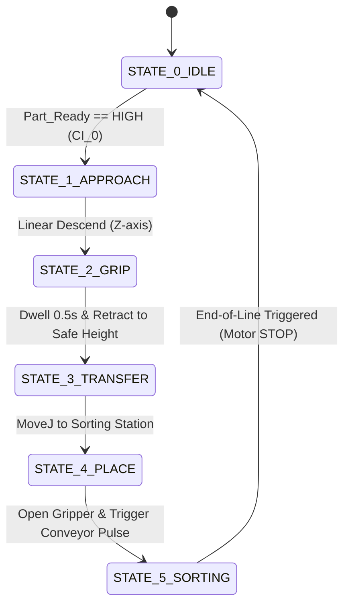

# Mechatronic Retrofit & Cobot Integration: UFACTORY Lite 6 with Festo MPS Training Stations

<p align="right">
  <a href="README.md">🌐 <b>English</b></a> &nbsp;|&nbsp; 
  <a href="README.es.md">🌐 <b>Español</b></a>
</p>

[](https://www.python.org/)
[](https://github.com/xArm-Developer/xArm-Python-SDK)
[](https://www.espressif.com/)
[](https://modbus.org/)
[](https://nodered.org/)
[](https://www.solidworks.com/)
[](#-experimental-validation--results)

A comprehensive mechatronic retrofit that converts a deteriorated, pneumatically dependent **Festo Modular Production System (MPS)** into an all-electric, Industry 4.0-ready flexible manufacturing cell. The legacy, non-operational Mitsubishi RV-2AJ manipulator was replaced with a **6-DOF UFACTORY Lite 6 collaborative robot**, coordinated through a centralized Python master architecture, custom optoisolated galvanic signal-conditioning circuitry and an independent **ESP32 + Node-RED Modbus TCP IIoT supervisory layer**.

Developed at **Faculty of Mechanical Engineering and Production Sciences (FIMCP), ESPOL**.

---

## 🎬 Operational Showcase & System Media

### Full Workcell Physical Operation
<p align="center">
  
  <br>
  <em>Figure 1: Fully integrated Lite 6 cobot executing sensor-guided pick-and-place transfer across Festo MPS stations.</em>
</p>

### Real-Time Supervisory HMI (Node-RED)
<p align="center">
  
  <br>
  <em>Figure 2: Real-time telemetry dashboard visualizing galvanic sensor feedback, conveyor actuation, and material identification via Modbus TCP.</em>
</p>

> 📺 **Demonstrations & Media Links:**  
> - 🎥 **[Full Operational Demonstration Video (YouTube)](https://youtu.be/qscHpI0cDj0)**  
> - 📊 **[Wokwi Circuit Simulation Model (JSON)](./firmware/wokwi_schematic.json)**  
> - 📑 **[Technical Engineering Paper & CAD Dossier (PDF)](./docs/DMECA_FINAL_G1.pdf)**  

---

## 📌 Engineering Challenges & Retrofit Strategy

| Legacy Limitation | Retrofit Engineering Solution |
| :--- | :--- |
| **Inoperative Industrial Robot:** Obsolete Mitsubishi RV-2AJ with proprietary controller and unobtainable spare parts. | Integrated a modern 6-DOF **UFACTORY Lite 6 cobot** mounted on an opposing modular table ("Face-to-Face" arrangement). |
| **Pneumatic Infrastructure Failure:** Damaged air hoses, leaky directional valves, and zero compressed-air availability in the lab. | Redesigned the entire transfer and sorting cycle to be **100% electrically actuated**, utilizing optocoupled sensor feedback. |
| **Communication Barrier:** Legacy Siemens S7-300 PLC restricted to closed Profibus-DP, preventing modern SCADA integration. | Implemented an **ESP32 "signal sniffing" bridge** that reads 24V industrial sensors passively without interfering with existing logic. |
| **Voltage Mismatch:** 24V DC industrial PNP/NPN sensors versus 3.3V DC microcontroller/cobot digital I/O. | Designed a custom DIN-rail PCB interface featuring **PC817 optocouplers** and electromechanical relay isolation modules. |

---

## ⚡ System Architecture

The manufacturing cell uses a decoupled, dual-tier architecture: **deterministic robot motion & sequencing control** is handled by the central Python runtime, while an **out-of-band IIoT sniffing layer** handles telemetry and operator visualization.

<p align="center">
  
  <br>
  <em>Figure 3: Hierarchical master-slave control architecture and parallel Modbus TCP monitoring network.</em>
</p>

### 1. Centralized Master Controller (ULite6 Controller)
- Directly executes the process Finite State Machine (FSM) via Python scripts utilizing the `xArm-Python-SDK`.
- Polls optoisolated digital inputs (`CI_0` to `CI_3`) for synchronous handshaking (`Part_Available`, `Entry_Sensor`, `End_of_Line`).
- Commands joint-interpolated trajectories (`MoveJ`) with a conservative speed profile ($20^\circ/\text{s}$) to preserve ISO collaborative safety envelopes.
- Actuates the conveyor DC motor driver through clean digital output contact pulses.

### 2. Parallel IIoT Telemetry Gateway (ESP32)
- Intercepts 24V sensor signals downstream of the PC817 galvanic isolation board.
- Broadcasts its own localized wireless network in **SoftAP Mode** (`SSID: FESTO MODBUS`, `IP: 192.168.4.1`), eliminating reliance on external campus Wi-Fi infrastructure.
- Runs an embedded **Modbus TCP Server** mapping 6 physical sensor channels directly to discrete holding registers (`mb.Ists`).

### 3. Supervisory HMI Dashboard (Node-RED)
- Operates as a Modbus TCP Client polling the ESP32 registers on a strict **200 ms cyclic loop**.
- Provides a responsive web interface displaying operational states (`IDLE`, `PART_AV`, `CONVEYOR_RUNNING`, `METAL_DETECTED`, `SAFETY_STOP`).

---

## 📐 Kinematic Modeling & Workspace Feasibility

To guarantee collision-free operation within the compact footprint and clear the stationary chassis of the legacy Mitsubishi robot, forward kinematics and workspace limits were modeled using the standard **Denavit-Hartenberg (D-H)** parameter formulation.

<p align="center">
  
  <br>
  <em>Figure 4: Workcell assembly modeling in SolidWorks.</em>
</p>

### Standard Denavit-Hartenberg Parameters

$$\mathbf{T}_{0}^{6} = \prod_{i=1}^{6} {}^{i-1}\mathbf{T}_i$$

| Link ($i$) | $\theta_i$ (deg) | $d_i$ (mm) | $a_i$ (mm) | $\alpha_i$ (deg) | Physical Description |
| :---: | :---: | :---: | :---: | :---: | :--- |
| **1** | $\theta_1$ | 243.3 | 0 | $-90^\circ$ | Base waist rotation |
| **2** | $\theta_2 - 90^\circ$ | 0 | 200.0 | $180^\circ$ | Shoulder pitch |
| **3** | $\theta_3 - 90^\circ$ | 0 | 87.0 | $90^\circ$ | Elbow pitch |
| **4** | $\theta_4$ | 227.6 | 0 | $90^\circ$ | Forearm roll |
| **5** | $\theta_5$ | 0 | 0 | $-90^\circ$ | Wrist pitch |
| **6** | $\theta_6$ | 61.5 | 0 | $0^\circ$ | End-effector tool flange |

$$\mathbf{R}_{\text{max}} \approx a_2 + \sqrt{d_4^2 + a_3^2} + d_6 \approx 200 + \sqrt{227.6^2 + 87^2} + 61.5 \approx \mathbf{505.1\text{ mm}}$$

* **Workspace Safety Envelopes:** All target waypoints ($P_{\text{pick}}$ at MPS Robot Station and $P_{\text{place}}$ on the Sorting conveyor) lie strictly within $\Vert{}P_{\text{target}}\Vert{} \le 0.9 R_{\text{max}} = 454.5\text{ mm}$, preventing kinematic singularities.
* **Safety Clearances:** The physical "Face-to-Face" table positioning was experimentally calibrated to maintain a minimum clearance of $>15\text{ mm}$ away from surrounding structural aluminum profiles.

---

## 🔄 Operational Logic: Process Finite State Machine (FSM)

The transfer and sorting logic is executed cyclically by the master script (`main_robot_control.py`):



1. **State 0 (Idle):** Robot holds at Home position ($[0^\circ, 0^\circ, 0^\circ, 0^\circ, 0^\circ, 0^\circ]$); gripper open; continuously polls optical trigger `CI_0`.
2. **State 1 (Approach):** High-speed approach to Pre-Pick waypoint located 100 mm above workpiece to eliminate lateral collision risks.
3. **State 2 (Gripping & Extraction):** Linear descent, closing of parallel electric jaws, 0.5-second settling dwell and vertical retraction to safe transport altitude.
4. **State 3 (Joint Transfer):** Coordinated 6-axis joint move sweeping past the legacy equipment envelope towards the entry of the Sorting conveyor.
5. **State 4 (Placement & Handshake):** Controlled workpiece deposition, simultaneous optoisolated relay pulse to engage the conveyor DC motor.
6. **State 5 (Sorting & Fail-Safe Stop):** Inductive sensor identifies material composition (metallic vs. non-metallic), conveyor halts immediately upon interrupting the optical End-of-Line beam (100% fail-safe reliability).

---

## 📊 Technical Specifications

| Parameter | Specification | Details |
| :--- | :--- | :--- |
| **Manipulator Arm** | UFACTORY Lite 6 | 6-DOF Collaborative Articulated Arm |
| **Working Envelope** | Reach: 440 mm (Max: 505.1 mm) | Repeatability: $\pm0.2\text{ mm}$, Rated Payload: 0.61 kg |
| **Master Controller** | ULite6 Embedded Linux Hub | Python 3.10 + `xArm-Python-SDK` |
| **Telemetry MCU** | ESP32-WROOM-32D | Dual-Core 32-bit Tensilica Xtensa @ 240 MHz |
| **Industrial Telemetry**| Modbus TCP | Standalone ESP32 SoftAP |
| **Signal Conditioning**| Galvanic Optoisolation | PC817 optocouplers (24V DC to 3.3V DC level shifting) |
| **Supervisory SCADA** | Node-RED Dashboard v3.6.6 | 200 ms cyclic polling rate, custom CSS styling |
| **Festo Stations** | Distributing & Sorting Stations | Modular Production System (MPS) hardware base |

---

## 📁 Repository Structure

```text
ufactory_festo_integration/
├── README.md                            # Main project technical case study (this file)
├── README.es.md                         # Versión en español del estudio de caso
├── docs/                                # Technical reports and engineering dossiers
│   ├── DMECA_FINAL_G1.pdf               # Comprehensive final mechatronic project report
│   └── Diseno_Informatico_DM_G1.pdf     # Embedded firmware, SCADA and software design report
├── src/
│   ├── robot/                           # Centralized master robotics software
│   │   ├── main_robot_control.py        # Python FSM script running on ULite6 controller
│   │   └── trajectories_config.py       # Calibrated joint waypoint angles and speed profiles
│   ├── firmware/                        # ESP32 embedded telemetry firmware
│   │   ├── esp32_modbus_gateway.ino     # SoftAP + Modbus TCP server C++ implementation
│   │   └── wokwi_schematic.json         # Simulated electrical testbench connections
│   └── scada/                           # Supervisory IoT monitoring layer
│       ├── nodered_flows.json           # Complete Node-RED Modbus client & dashboard flow
│       └── dashboard_styling.css        # Custom CSS styling for the industrial HMI
├── hardware/                            # CAD assets, assemblies, and schematics
│   ├── cad/                             # SolidWorks 3D models of stations & mounts
│   └── schematics/                      # Optocoupled signal isolation wiring diagrams
└── media/                               # Visual assets, operational GIFs, and renders
    ├── workcell_operation.gif           # Real physical manufacturing cell operation
    ├── dashboard_nodered_live.png       # Live telemetry supervision interface
    ├── control_architecture_diagram.png # Control and network topology schematic
    └── cad_workcell_layout.png          # Complete SolidWorks 3D cell arrangement
```

---

## 👥 Engineering & Development Team

- **Emmanuel Rivas Pincay** — Lead Systems Integration & Control Engineer  
  *Mechatronics Engineering, ESPOL*
  **Core Contributions:** Kinematic workspace modeling, centralized Python FSM architecture, optocoupled signal conditioning design, Modbus TCP gateway implementation and cell commissioning.  
  [LinkedIn](https://linkedin.com/in/emmanuel-rivas-pincay-a25334221) | [Email](mailto:egrivas64@gmail.com)

- **Eliezer Acebo Mota** — Mechanical Design & Automation Engineer
  *Mechatronics Engineering, ESPOL*  
  **Core Contributions:** Station layout planning and Festo station maintenance.

- **Génesis Dayanna Vargas Isa** — Software & IIoT Developer 
  *Mechatronics Engineering, ESPOL*  
  **Core Contributions:** Node-RED flow architecture, HMI UI/UX dashboard styling and Wokwi simulation testing.

- **Steven Cisneros Villón** — Electrical & Automation Engineer  
  *Mechatronics Engineering, ESPOL* 
  **Core Contributions:** Industrial wiring, sensor characterization and hardware bench testing.

### 🏛️ Academic Course & Supervision
- **Course:** Mechatronic Design (*Diseño Mecatrónico*) — Group 1
- **Faculty:** Faculty of Mechanical Engineering and Production Sciences (FIMCP)  
- **Institution:** Escuela Superior Politécnica del Litoral (ESPOL), Guayaquil, Ecuador
